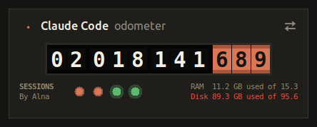
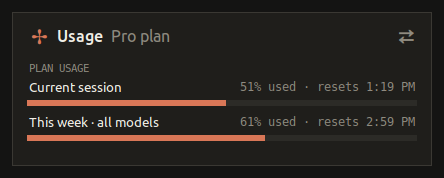

# Token Mileage: Claude Code Odometer

A live token counter for Claude Code, styled like a classic car odometer in Claude Code's colours. It sits on your desktop and shows how many tokens you have used, which sessions are working, and how much of your plan you have left.

By Alna (Ebrahim Alnasser).

| Front: the odometer | Back: plan usage (flip with ⇄) |
|---|---|
|  |  |

- **Front:** rolling digit drums showing every token Claude Code has used on this device, in full. There is one dot per open Claude Code terminal: **orange pulsing** = working, **green glow** = finished. Hover a dot to see the session name. Bottom right: RAM and disk used of total, in red above 90%.
- **Back** (flip with ⇄): **plan usage**, the same bars `/usage` shows for the account signed in to Claude Code (current session and this week for all models), with % used and reset time, and the email of the signed-in account. Bars turn red at 90%.
- **Light:** it sleeps when nothing changes and uses about 1-2% of one CPU core while running.
- **Command line:** a full report by day, project, model and session, with API-price estimates and an optional HTML report.

Only the Python standard library is needed (Python 3.9+ with Tk). Works on Linux, macOS and Windows.

## Set up with Claude Code (easiest)

```bash
git clone https://github.com/ebrahim-cyber-bh/Token_Mileage.git
cd Token_Mileage
claude
```

Then say **"set this up"** (or type `/setup`). Claude Code checks your computer (Python, Tk, Claude Code sign-in), asks a few questions (your name for reports, shortcuts, start at login) and installs and opens the odometer. It works the same on Windows, macOS and Linux.

## Set up by hand

```bash
python3 doctor.py                          # checks what this computer needs
python3 install.py --owner "Your Name"     # desktop shortcut + app menu / Start Menu
python3 install.py --autostart             # optional: start when you log in
python3 install.py --launch                # open it now
python3 install.py --uninstall             # remove shortcuts (keeps your history)
```

- **Windows:** use `py` instead of `python3` (for example `py install.py --owner "Your Name"`). Python from python.org includes Tk. The shortcut opens with `pythonw`, so no console window stays open. Scaled displays (125-200%) are supported.
- **Linux:** if Tk is missing, `sudo apt install python3-tk`.
- **macOS:** Python from python.org includes Tk (with Homebrew: `brew install python-tk`).

## How the numbers stay accurate

- It reads Claude Code's own logs (`~/.claude/projects`, or `$CLAUDE_CONFIG_DIR/projects`), the same data Claude Code records for every reply.
- Each reply is written to the log several times while it streams. Entries are merged by message id so nothing is counted twice. Without this merge, totals would be about 2× too high.
- Claude Code deletes logs older than 30 days by default. The odometer keeps its own ledger, so the total never goes backwards:
  - Linux: `~/.local/share/claude-odometer/`
  - macOS: `~/Library/Application Support/claude-odometer/`
  - Windows: `%LOCALAPPDATA%\claude-odometer\`
- "Tokens" means everything Claude processed: input, output, cache writes and cache reads. Usually more than 95% is **cache reads**, because each reply re-reads the conversation so far. That is why totals reach hundreds of millions quickly.
- Live status comes from Claude Code's session files (`~/.claude/sessions`).
- Each device counts its own usage. Token data is never uploaded anywhere.

## Plan usage (the bars)

- It uses Claude Code's own sign-in on this device (`~/.claude/.credentials.json`, or the Keychain on macOS) and asks `api.anthropic.com` for the account's limits every 2 minutes. The sign-in is never printed, saved or sent anywhere else.
- If the sign-in has expired, open Claude Code once and the bars come back. The odometer never refreshes the sign-in itself, so it can't sign Claude Code out.
- It uses the same endpoint as Claude Code's `/usage`, which is **not a public API**. If it changes, the card says "Usage not available" and everything else keeps working.
- To check from a terminal: `python3 plan_usage.py`

## Command-line report

```bash
python3 token_calc.py              # all time, with API-price estimates
python3 token_calc.py --today
python3 token_calc.py --days 7
python3 token_calc.py --json       # totals as JSON (for scripts)
python3 token_calc.py --html       # also writes report.html (git-ignored: it holds your usage)
```

Costs are estimates at Anthropic API list prices. On a Pro/Max subscription this is the API-equivalent value of your usage, not your bill.

## Files

| File | What it does |
|---|---|
| `token_popup.py` | The desktop odometer (Tkinter): front odometer, session dots, RAM/disk, flip animation, plan-usage card |
| `token_calc.py` | Reads Claude Code logs, removes duplicates, keeps the ledger, prices, CLI and HTML report |
| `plan_usage.py` | Plan limits (`/usage` bars) for the signed-in account |
| `install.py` | Shortcuts (desktop, app menu / Start Menu), start at login, owner name, launch, uninstall |
| `doctor.py` | Checks what this computer needs before setup |
| `icon.svg` | App icon |
| `screenshots/` | Front and back of the widget |
| `CLAUDE.md`, `.claude/skills/setup/` | Notes and the `/setup` flow for Claude Code |
| `AGENTS.md` | Rules for other AI coding tools |
| `LICENSE` | MIT with an attribution clause |

## License

MIT with one extra condition: the author credit **"By Alna"** at the bottom left of the odometer must stay visible and unchanged in every copy and modified version. You can add your own name with `install.py --owner`. See [LICENSE](LICENSE).
